# Лабораторная работа №4. Облачные хранилища. Amazon S3

- **ФИО:** Анисимов Виктор
- **Группа:** IA2403
- **Специальность:** Informatică aplicată
- **Уровень:** Advanced
- **Репозиторий:** https://github.com/RisovoePole-cloud/timecapsule

# Часть 1. Базовый уровень

## Задание 1. Бакет и объекты в консоли

Создал бакет `timecapsule-dev-uploads-risovoepole` (ACL отключены, публичный доступ закрыт, шифрование SSE-S3, теги), папки `uploads` и `backups`, загрузил картинку и PDF в `uploads/`, текстовый файл в `backups/`.

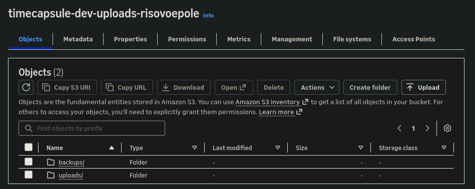

Бакет с папками `uploads/` и `backups/`.

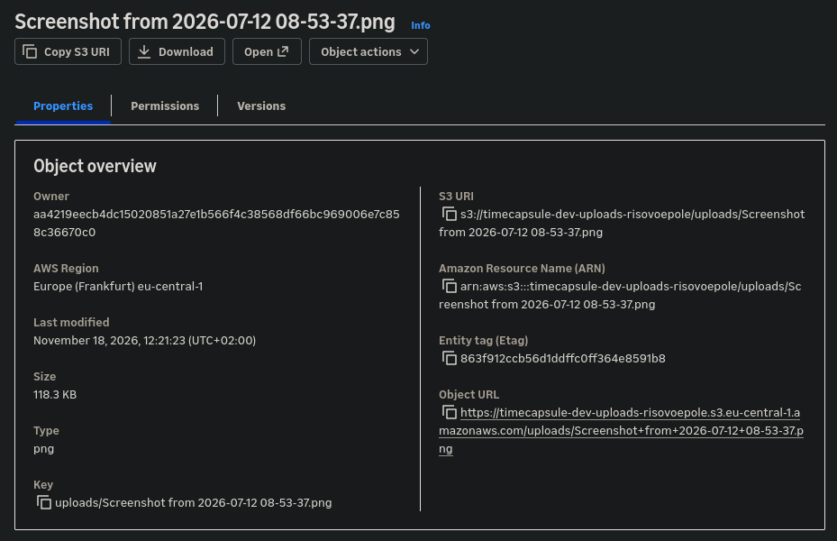

Свойства картинки: ключ, Content-Type, ETag, Object URL.

**Q:** Какой ключ у картинки? Почему Object URL не открывается, хотя вы владелец бакета? Что на самом деле создала кнопка Create folder?

**A:** Ключ картинки `uploads/Screenshot from 2026-07-12 08-53-37.png`: «папки» это просто часть ключа. Object URL это обычный анонимный запрос без подписи, а объект приватный (Block Public Access включён, публичных политик нет), поэтому владение бакетом не помогает: браузер не передаёт учётные данные. Кнопка Create folder создала пустой (0 байт) объект, ключ которого заканчивается на `/` (например, `uploads/`); в `aws s3 ls` он виден как строка нулевого размера.

## Задание 2. Объекты из CLI

```fish
$ set BUCKET timecapsule-dev-uploads-risovoepole
$ aws s3 cp photo.txt s3://$BUCKET/uploads/photo.txt
upload: ./photo.txt to s3://timecapsule-dev-uploads-risovoepole/uploads/photo.txt
$ aws s3 sync 2026 s3://$BUCKET/uploads/2026
upload: 2026/10/report-2.txt to s3://timecapsule-dev-uploads-risovoepole/uploads/2026/10/report-2.txt
upload: 2026/10/report.txt to s3://timecapsule-dev-uploads-risovoepole/uploads/2026/10/report.txt
$ aws s3 ls s3://$BUCKET
                           PRE backups/
                           PRE uploads/
$ aws s3 ls s3://$BUCKET/uploads/
                           PRE 2026/
2026-11-18 12:20:58          0
2026-11-18 12:21:23     121174 Screenshot from 2026-07-12 08-53-37.png
2026-11-18 12:21:23    1042157 file-example_PDF_1MB.pdf
2026-11-18 12:27:44         18 photo.txt
$ aws s3 ls s3://$BUCKET --recursive
2026-11-18 12:21:40          0 backups/
2026-11-18 12:22:34        607 backups/sample1.txt
2026-11-18 12:20:58          0 uploads/
2026-11-18 12:28:03         17 uploads/2026/10/report-2.txt
2026-11-18 12:28:03         15 uploads/2026/10/report.txt
2026-11-18 12:21:23     121174 uploads/Screenshot from 2026-07-12 08-53-37.png
2026-11-18 12:21:23    1042157 uploads/file-example_PDF_1MB.pdf
2026-11-18 12:27:44         18 uploads/photo.txt
```

```fish
$ aws s3api head-object --bucket $BUCKET --key 'uploads/2026/10/report.txt'
{
    "AcceptRanges": "bytes",
    "LastModified": "2026-11-18T10:28:03+00:00",
    "ContentLength": 15,
    "ETag": "\"b226e1a3649a6073b10d77b8cc66d8f5\"",
    "ContentType": "text/plain",
    "ServerSideEncryption": "AES256",
    "Metadata": {}
}
$ aws s3api head-object --bucket $BUCKET --key 'uploads/Screenshot from 2026-07-12 08-53-37.png'
{
    "AcceptRanges": "bytes",
    "LastModified": "2026-11-18T10:21:23+00:00",
    "ContentLength": 121174,
    "ETag": "\"863f912ccb56d1ddffc0ff364e8591b8\"",
    "ContentType": "image/png",
    "ServerSideEncryption": "AES256",
    "Metadata": {}
}
```

**Q:** Почему первая команда ls показывает PRE uploads/ и PRE backups/, а третья показывает полные ключи? Какой Content-Type получил report.txt, хотя вы его не указывали?

**A:** Плоское хранилище группирует ключи по разделителю `/`: без `--recursive` `ls` показывает только первый уровень, а общие префиксы выводит как `PRE`. С `--recursive` разделитель не используется, и выводятся все ключи целиком. `report.txt` получил `text/plain`: CLI определяет Content-Type по расширению файла `.txt`.

## Задание 3. Политика бакета: только HTTPS

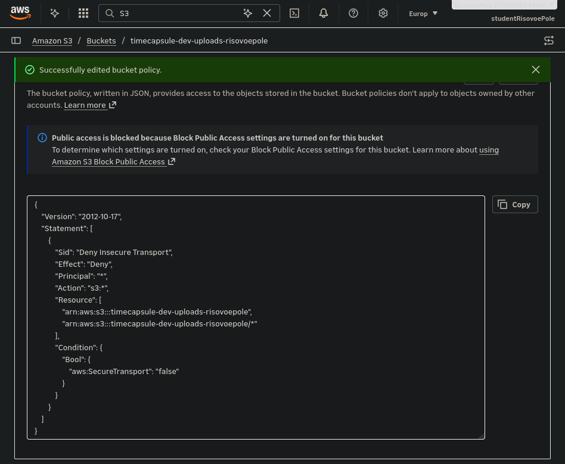

Политика бакета: `Deny` для `s3:*` с `Principal: *`, если `aws:SecureTransport` равно `false`.

```fish
$ aws s3 ls s3://$BUCKET/uploads/
                           PRE 2026/
2026-11-18 12:20:58          0
2026-11-18 12:21:23     121174 Screenshot from 2026-07-12 08-53-37.png
2026-11-18 12:21:23    1042157 file-example_PDF_1MB.pdf
2026-11-18 12:27:44         18 photo.txt
$ aws s3 ls s3://$BUCKET/uploads/ --endpoint-url http://s3.eu-central-1.amazonaws.com

aws: [ERROR]: An error occurred (AccessDenied) when calling the ListObjectsV2 operation: User: arn:aws:iam::371892604446:user/studentRisovoePole is not authorized to perform: s3:ListBucket on resource: "arn:aws:s3:::timecapsule-dev-uploads-risovoepole" with an explicit deny in a resource-based policy
```

**Q:** Почему вторая команда получает AccessDenied, хотя у вас права администратора? Почему Block Public Access не помешал сохранить политику с "Principal": "*"?

**A:** Вторая команда идёт по HTTP, и срабатывает явный запрет в политике бакета (`SecureTransport = false`). Явный Deny всегда сильнее любого Allow, в том числе прав администратора (в ошибке так и написано: `explicit deny in a resource-based policy`). Block Public Access блокирует политики, которые *открывают* доступ всем; наша политика ничего не разрешает, а только запрещает, поэтому публичной она не считается.

## Задание 4. Версионирование

Включил версионирование, создал `notes.txt` (`v1`), перезаписал (`v2`), удалил файл, затем удалил маркер удаления, а потом версию `v2`.

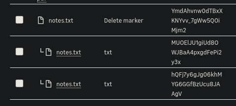

Список версий `notes.txt`: маркер удаления лежит поверх версий `v2` и `v1`, файл в обычном списке не виден.

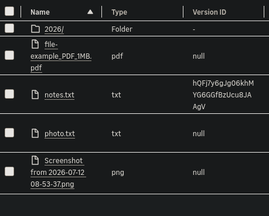

После удаления маркера и версии `v2` текущей остаётся версия `v1`.

## Задание 5. Правило жизненного цикла

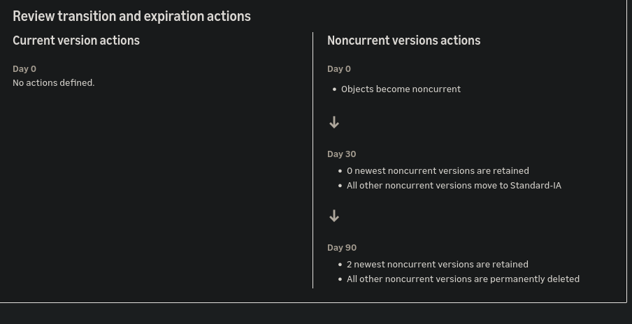

Правило `timecapsule-dev-noncurrent` для префикса `uploads/`: неактуальные версии переходят в `Standard-IA` через 30 дней, удаляются через 90 дней (сохраняются 2 новейшие неактуальные), незавершённые загрузки частями отменяются через 7 дней.

**Q:** Как поведёт себя правило для файла, который перезаписывали 10 раз за неделю? Какие версии и когда окажутся в Standard-IA, какие будут удалены? Почему наши маленькие тестовые файлы в Standard-IA не попадут? Что такое незавершённая загрузка частями и почему за неё приходится платить?

**A:** У файла будет 1 актуальная и 9 неактуальных версий. Сроки считаются от момента, когда версия стала неактуальной: актуальную версию правило не трогает, через 30 дней каждая неактуальная версия уходит в Standard-IA, а через 90 дней удаляются неактуальные версии, кроме двух новейших. За неделю до этих сроков ничего не дойдёт, всё останется в Standard. Тестовые файлы маленькие: S3 по умолчанию не переводит в Standard-IA объекты меньше 128 КБ (минимальный размер для тарифа этого класса), к тому же они ещё слишком свежие. Незавершённая загрузка частями это большой файл, часть кусков которого уже загружена, но загрузка не завершена и не отменена; такие куски не видны в обычном списке, но занимают место и оплачиваются, пока их не отменит правило.

## Задание 6. Подписанные ссылки

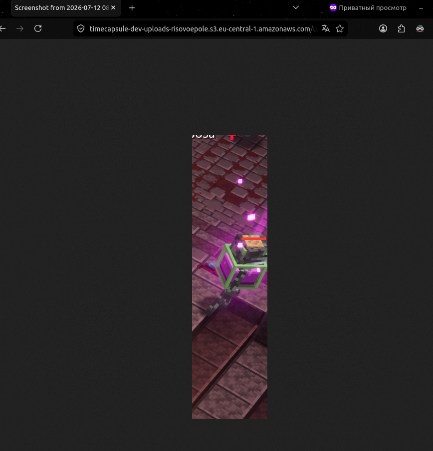

Подписанная ссылка на 5 минут, открытая в приватном окне.

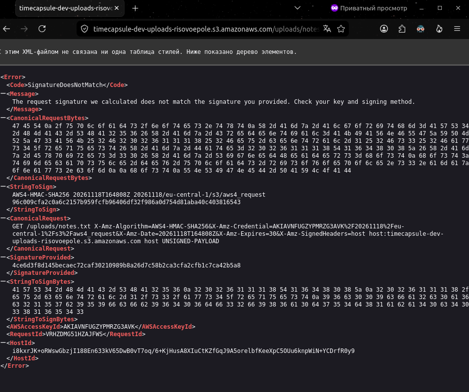

Ответ S3 на ссылку с изменённым ключом.

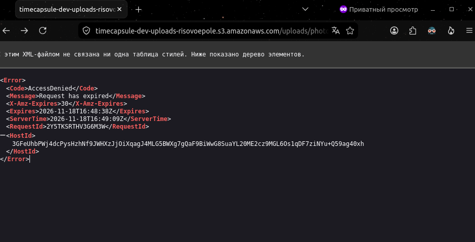

Ответ S3 на просроченную ссылку: `AccessDenied`, `Request has expired`.

**Q:** Какие ошибки вернул S3 в шагах 3 и 4? Почему нельзя получить другой файл, просто поменяв ключ в ссылке? Обращалась ли команда aws s3 presign к S3, когда создавала ссылку?

**A:** В шаге 3 (изменён ключ) S3 вернул `SignatureDoesNotMatch`, в шаге 4 (ссылка просрочена) `AccessDenied: Request has expired`. Подпись считается от ключа, метода, срока и других параметров запроса, поэтому при замене ключа она перестаёт совпадать, и другой файл получить нельзя. Команда `aws s3 presign` к S3 не обращалась: подпись считается локально по секретному ключу, сеть для этого не нужна.

# Часть 2. Продвинутый уровень

## Задания 7-8. Политика приложения и проверка прав

Политика приложения `timecapsule-dev-app-s3`:

```json
{
	"Version": "2012-10-17",
	"Statement": [
		{
			"Sid": "AllowListUploadsPrefix",
			"Effect": "Allow",
			"Action": "s3:ListBucket",
			"Resource": "arn:aws:s3:::timecapsule-dev-uploads-risovoepole",
			"Condition": {
				"StringLike": {
					"s3:prefix": [
						"uploads/*"
					]
				}
			}
		},
		{
			"Sid": "AllowObjectActionsInUploads",
			"Effect": "Allow",
			"Action": [
				"s3:GetObject",
				"s3:PutObject",
				"s3:DeleteObject"
			],
			"Resource": "arn:aws:s3:::timecapsule-dev-uploads-risovoepole/uploads/*"
		}
	]
}
```

**Q:** Почему s3:ListBucket относится к ресурсу «бакет», а s3:GetObject к ресурсу «объект»? Что произойдёт, если перепутать ARN в этих двух правилах?

**A:** `ListBucket` это операция над бакетом целиком (перечисление ключей), поэтому ей нужен ARN бакета без `/*`; `GetObject` работает с отдельным объектом, и ему нужен ARN вида `bucket/ключ`. Если перепутать, правила просто не сработают: `ListBucket` с ARN `.../uploads/*` не совпадёт с ресурсом «бакет», и листинг будет запрещён, а `GetObject` с ARN бакета не совпадёт ни с одним объектом, и чтение не заработает.

Вывод от имени тестовой роли:

```fish
$ aws sts get-caller-identity
{
    "UserId": "AROAVNFUGZYPBWOQMHRRL:lab4",
    "Account": "371892604446",
    "Arn": "arn:aws:sts::371892604446:assumed-role/timecapsule-dev-s3-tester/lab4"
}
```

| №   | Команда                                                                                    | Ожидаю | Получил | Какое правило сработало        |
| --- | ------------------------------------------------------------------------------------------ | ------ | ------- | ------------------------------ |
| 1   | `aws s3 cp test.txt s3://$BUCKET/uploads/test.txt`                                         | +      | +       | разрешение в политике приложения |
| 2   | `aws s3 ls s3://$BUCKET/uploads/`                                                          | +      | +       | разрешение в политике приложения |
| 3   | `aws s3 ls s3://$BUCKET`                                                                   | -      | -       | неявный запрет                 |
| 4   | `aws s3 cp s3://$BUCKET/uploads/photo.txt -`                                               | +      | +       | разрешение в политике приложения |
| 5   | `aws s3 ls s3://$BUCKET/backups/`                                                          | -      | -       | неявный запрет                 |
| 6   | `aws s3 cp test.txt s3://$BUCKET/backups/test.txt`                                         | -      | -       | неявный запрет                 |
| 7   | `aws s3api list-object-versions --bucket $BUCKET --prefix uploads/`                        | -      | -       | неявный запрет                 |
| 8   | `aws s3api delete-object --bucket $BUCKET --key uploads/test.txt --version-id <VersionId>` | -      | -       | неявный запрет                 |
| 9   | `aws s3 rm s3://$BUCKET/uploads/test.txt`                                                  | +      | +       | разрешение в политике приложения |
| 10  | `aws s3 ls s3://$BUCKET/uploads/ --endpoint-url http://s3.eu-central-1.amazonaws.com`      | -      | -       | явный запрет в политике бакета |

**Q:** Чем политика доверия роли отличается от политики прав? Что на самом деле произошло с test.txt после команды 9, и можно ли его восстановить? Сможет ли злоумышленник, получивший учётные данные приложения, уничтожить файлы пользователей без возможности восстановления? А если бы в политике было "s3:*"?

**A:** Политика доверия отвечает на вопрос «кто может принять роль», политика прав на вопрос «что можно делать от её имени». После команды 9 `test.txt` не удалился физически: версионирование добавило маркер удаления, а версия осталась, и файл можно восстановить, удалив маркер (администратором). Злоумышленник с учётными данными приложения может удалять текущие объекты (команда 9), но не может удалить конкретную версию (`DeleteObjectVersion` не разрешён, команда 8) и даже посмотреть список версий (команда 7), поэтому безвозвратно уничтожить данные не может. С `s3:*` он смог бы удалять версии навсегда, отключить версионирование и менять политики, и тогда восстановление было бы невозможно.

## Задание 9. Роль для сервера

```bash
[ec2-user@ip-10-2-0-37 ~]$ aws sts get-caller-identity
{
    "UserId": "AROAVNFUGZYPIJNWAIZHA:i-07379b4c4980e7737",
    "Account": "371892604446",
    "Arn": "arn:aws:sts::371892604446:assumed-role/timecapsule-dev-app-role/i-07379b4c4980e7737"
}
[ec2-user@ip-10-2-0-37 ~]$ aws s3 ls s3://$BUCKET/uploads/
                           PRE 2026/
2026-11-18 10:20:58          0
2026-11-18 10:21:23     121174 Screenshot from 2026-07-12 08-53-37.png
2026-11-18 10:21:23    1042157 file-example_PDF_1MB.pdf
2026-11-18 10:49:30          3 notes.txt
2026-11-18 10:27:44         18 photo.txt
2026-11-18 17:23:51          9 test.txt
[ec2-user@ip-10-2-0-37 ~]$ aws s3 ls s3://$BUCKET/backups/

An error occurred (AccessDenied) when calling the ListObjectsV2 operation: User: arn:aws:sts::371892604446:assumed-role/timecapsule-dev-app-role/i-07379b4c4980e7737 is not authorized to perform: s3:ListBucket on resource: "arn:aws:s3:::timecapsule-dev-uploads-risovoepole" because no identity-based policy allows the s3:ListBucket action
```

**Q:** Где AWS CLI на сервере взял учётные данные, если вы не выполняли aws configure и не вызывали assume-role? Чем политика доверия этой роли отличается от тестовой? Почему такие учётные данные безопаснее ключа доступа в файле .env?

**A:** Роль прикреплена к экземпляру (instance profile), и CLI сам получает временные учётные данные из сервиса метаданных экземпляра. Политика доверия этой роли разрешает принимать её сервису EC2, а у тестовой роли доверенной стороной был мой аккаунт. Такие данные временные и ротируются автоматически, нигде не хранятся в файлах и не попадут в репозиторий; ключ в `.env` долгоживущий, и при утечке им можно пользоваться, пока его не отзовут.

## Задание 10. Перенос существующих файлов

**Q:** Хватило ли для aws s3 sync прав политики приложения? Какие из разрешённых действий использовала команда?

**A:** Хватило. `sync` использует `s3:ListBucket` (список объектов по префиксу `uploads/` для сравнения с локальными файлами) и `s3:PutObject` (загрузка новых). `GetObject` и `DeleteObject` команда не использует (без `--delete`), поэтому её можно безопасно повторять.

```bash
[ec2-user@ip-10-2-0-37 timecapsule]$ aws s3 sync storage/uploads s3://$BUCKET/uploads/ --dryrun
(dryrun) upload: storage/uploads/.gitkeep to s3://timecapsule-dev-uploads-risovoepole/uploads/.gitkeep
(dryrun) upload: storage/uploads/7e215dfd4c389bab7dd7d2af736ae2df.png to s3://timecapsule-dev-uploads-risovoepole/uploads/7e215dfd4c389bab7dd7d2af736ae2df.png
[ec2-user@ip-10-2-0-37 timecapsule]$ aws s3 sync storage/uploads s3://$BUCKET/uploads/
upload: storage/uploads/.gitkeep to s3://timecapsule-dev-uploads-risovoepole/uploads/.gitkeep
upload: storage/uploads/7e215dfd4c389bab7dd7d2af736ae2df.png to s3://timecapsule-dev-uploads-risovoepole/uploads/7e215dfd4c389bab7dd7d2af736ae2df.png
```

## Задание 11. Модуль хранения на S3

[Коммит перехода хранилища вложений на S3](https://github.com/RisovoePole-cloud/timecapsule/commit/cd6e5ee9ad8aa9ee28f10302951c2ef2acac7db1)

## Задание 12. Проверка приложения

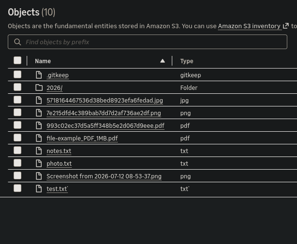

Новые объекты в бакете после создания капсул с картинкой и PDF.

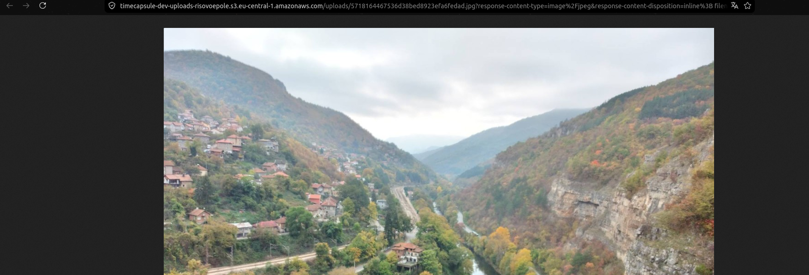

Адресная строка с подписанным URL (`s3.eu-central-1.amazonaws.com`, параметры `X-Amz-*`).

Через 5 минут тот же URL отвечает ошибкой `AccessDenied`, `Request has expired`.

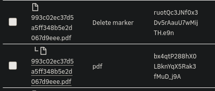

После удаления капсулы с PDF на объекте появился маркер удаления, версия сохранилась.

**Q:** Почему ссылку, которую пользователь переслал другу, не нужно специально отзывать? Что осталось в бакете после удаления капсулы и когда это исчезнет окончательно?

**A:** Подпись в ссылке включает срок действия (5 минут), по истечении которого S3 сам отвечает `Request has expired`, поэтому ссылку не нужно отзывать. После удаления капсулы объект физически остался: версионирование поставило поверх него маркер удаления, а сама версия стала неактуальной. По правилу жизненного цикла неактуальные версии удаляются через 90 дней, но не более новые 2 из них сохраняются; поэтому единственная версия удалённой капсулы по настроенному правилу будет храниться дольше, а окончательно исчезнет только при удалении версии вручную.

## Задание 13. Сервер без состояния

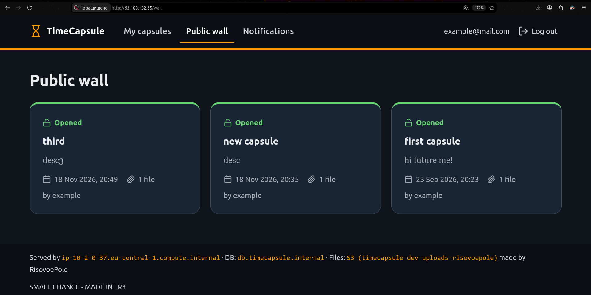

Приложение с вложениями работает после удаления `storage/uploads` на сервере.

Ужесточил политику: убрал из политики приложения `s3:ListBucket`. Проверка с `app-server`:

```bash
[ec2-user@ip-10-2-0-37 timecapsule]$ aws s3 ls s3://$BUCKET/uploads/

An error occurred (AccessDenied) when calling the ListObjectsV2 operation: User: arn:aws:sts::371892604446:assumed-role/timecapsule-dev-app-role/i-07379b4c4980e7737 is not authorized to perform: s3:ListBucket on resource: "arn:aws:s3:::timecapsule-dev-uploads-risovoepole" because no identity-based policy allows the s3:ListBucket action
```

Запрос несуществующего объекта, на сервере и в CloudShell/на компьютере:

```bash
[ec2-user@ip-10-2-0-37 timecapsule]$ aws s3 cp s3://$BUCKET/uploads/no-such-file.txt -
download failed: s3://timecapsule-dev-uploads-risovoepole/uploads/no-such-file.txt to - An error occurred (403) when calling the HeadObject operation: Forbidden
```

```fish
$ aws s3 cp s3://timecapsule-dev-uploads-risovoepole/uploads/no-such-file.txt -
download failed: s3://timecapsule-dev-uploads-risovoepole/uploads/no-such-file.txt to - An error occurred (404) when calling the HeadObject operation: Not Found
```

**Q:** Почему S3 ответил вам и серверу по-разному, хотя объекта нет в обоих случаях? Зачем S3 так поступает? Что теперь нужно сделать, чтобы заменить app-server новым сервером без потери данных?

**A:** У моего пользователя (администратор) есть право `s3:ListBucket`, поэтому S3 честно говорит, что объекта нет (404). У роли сервера этого права больше нет, и S3 отвечает `403` и для отсутствующего, и для недоступного объекта, чтобы не раскрывать, существует ли ключ. Это защищает от перебора ключей: по ответам нельзя узнать, какие файлы лежат в бакете. Чтобы заменить `app-server`, достаточно запустить новый сервер с тем же кодом, `.env` (`S3_BUCKET`, `AWS_REGION`, настройки базы) и прикрепить к нему ту же роль `timecapsule-dev-app-role`: файлы в S3, данные в базе, на самом сервере состояния нет, копировать ничего не нужно.

# Архитектура

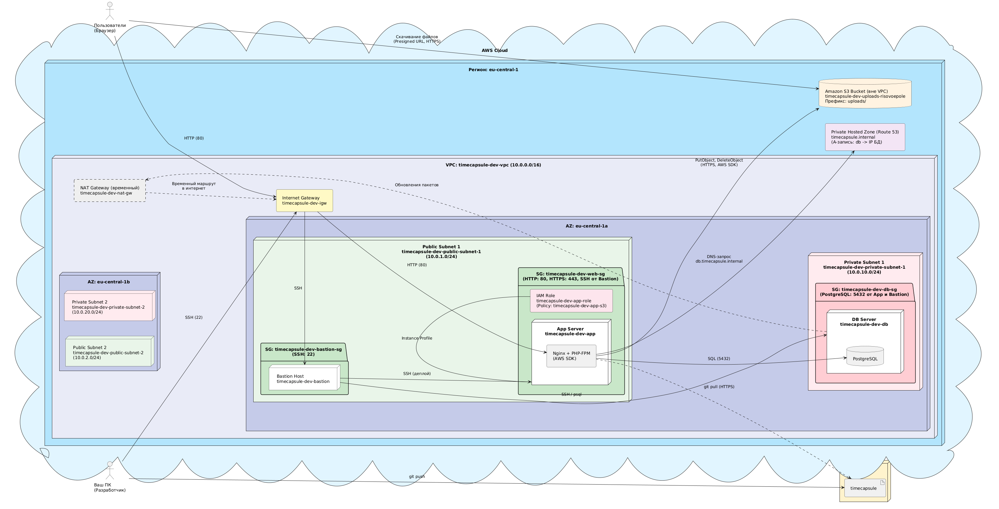

Схема архитектуры: S3-бакет вне VPC (префикс `uploads/`), роль `timecapsule-dev-app-role` у `app-server`, стрелки приложение → S3 и браузер → S3 по подписанной ссылке.

Решение о хранении вложений: [ADR-0003](docs/adr/0003-attachment-storage.md).
